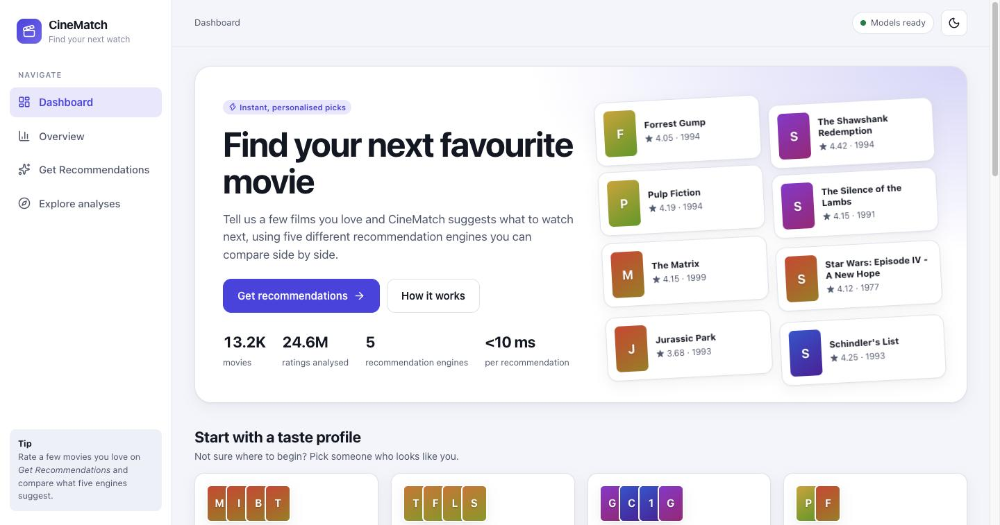
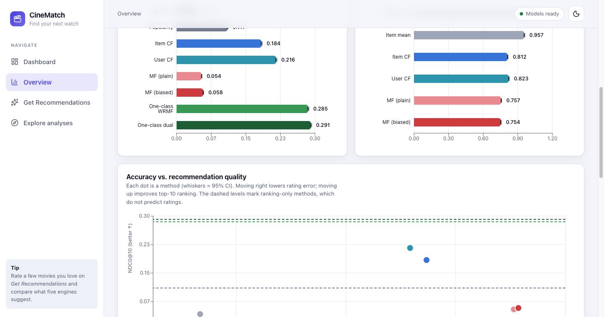
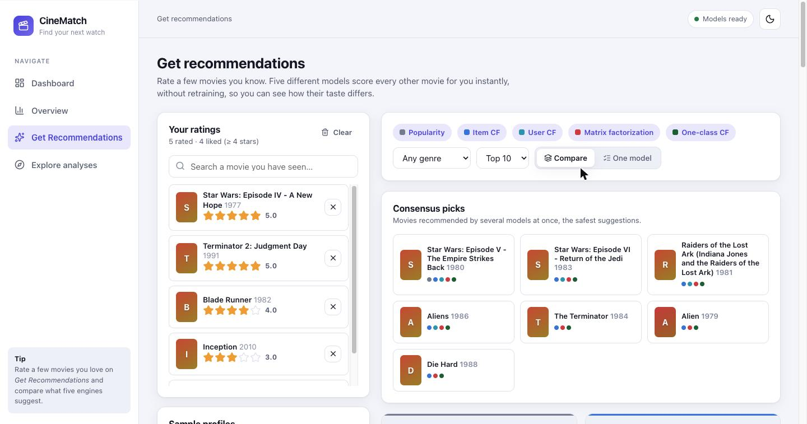
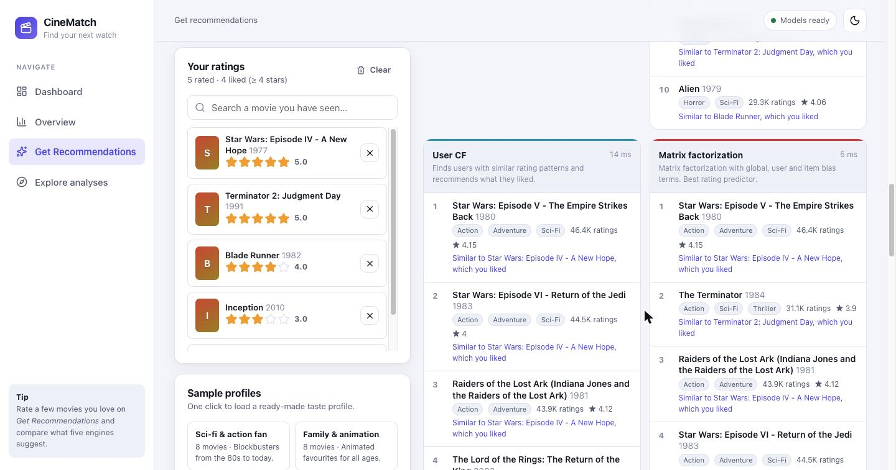
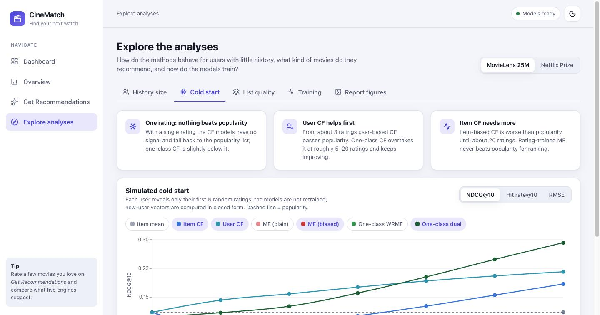
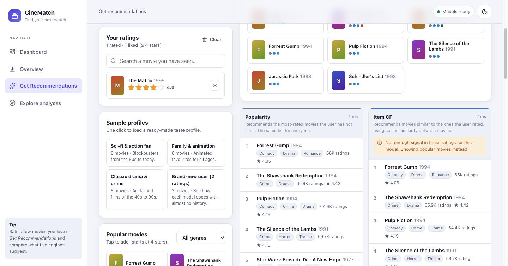

# Personalized Movie Recommendation System Using Collaborative Filtering

The project builds and compares movie recommenders on two public rating datasets and asks _why_ one approach beats another on the same data, not just which number is lower.

| Method                                            | What it is                                                                                                                              |
| ------------------------------------------------- | --------------------------------------------------------------------------------------------------------------------------------------- |
| Popularity / mean-rating baselines                | Non-personalized reference points                                                                                                       |
| User-based and item-based collaborative filtering | Neighbourhood methods; cosine similarity on mean-centred ratings with significance weighting                                            |
| Matrix factorization (SGD)                        | `R ≈ P Qᵀ` with L2 regularization; plain and biased variants                                                                            |
| One-class collaborative filtering                 | Positives-only weighted matrix factorization (ALS), plus a dual (user/item graph) regularized variant inspired by Yao et al., CIKM 2014 |

**Research questions:**

(1) Can CF predict user preferences accurately?

(2) Does matrix factorization improve recommendation quality?

(3) How does MF compare with simple methods?

(4) How well can the system recommend movies a user has not rated?

(5) How does the model behave when a user has little rating history?

## Results

<!-- RESULTS-TABLE-START -->
**MovieLens 25M** — ranking metrics over 152,012 users

| Method | RMSE | MAE | P@10 | R@10 | Hit@10 | NDCG@10 |
|:--|---:|---:|---:|---:|---:|---:|
| Global mean | 1.0582 | 0.8397 | – | – | – | – |
| Mean rating (min 50 ratings) | 0.9568 | 0.7397 | 0.0265 | 0.0433 | 0.2075 | 0.0418 |
| Popularity (most rated) | – | – | 0.0676 | 0.1070 | 0.4060 | 0.1105 |
| Item-based CF | 0.8125 | 0.6098 | 0.1084 | 0.1652 | 0.5421 | 0.1842 |
| User-based CF | 0.8229 | 0.6189 | 0.1206 | 0.2100 | 0.6020 | 0.2160 |
| MF (plain) | 0.7568 | 0.5719 | 0.0351 | 0.0484 | 0.2367 | 0.0543 |
| MF (biased) | **0.7539** | **0.5690** | 0.0370 | 0.0542 | 0.2564 | 0.0579 |
| One-class WRMF | – | – | 0.1627 | 0.2783 | 0.6993 | 0.2852 |
| One-class dual-regularized | – | – | **0.1658** | **0.2834** | **0.7041** | **0.2914** |

**Netflix Prize (50,000-user sample)** — ranking metrics over 48,264 users

| Method | RMSE | MAE | P@10 | R@10 | Hit@10 | NDCG@10 |
|:--|---:|---:|---:|---:|---:|---:|
| Global mean | 1.0813 | 0.9060 | – | – | – | – |
| Mean rating (min 50 ratings) | 1.0095 | 0.8098 | 0.0321 | 0.0216 | 0.2197 | 0.0408 |
| Popularity (most rated) | – | – | 0.0678 | 0.0649 | 0.3782 | 0.0889 |
| Item-based CF | 0.8723 | 0.6692 | 0.1246 | 0.1157 | 0.5589 | 0.1711 |
| User-based CF | 0.8830 | 0.6793 | 0.1202 | 0.1100 | 0.5387 | 0.1664 |
| MF (plain) | **0.8241** | 0.6395 | 0.0381 | 0.0265 | 0.2308 | 0.0486 |
| MF (biased) | 0.8253 | **0.6384** | 0.0368 | 0.0246 | 0.2279 | 0.0466 |
| One-class WRMF | – | – | **0.1985** | **0.1954** | **0.7076** | **0.2709** |
| One-class dual-regularized | – | – | 0.1970 | 0.1916 | 0.7012 | 0.2691 |

_RMSE and MAE come from each method's configuration with the best *validation* RMSE; ranking metrics (K = 10 here; relevant = held-out rating ≥ 4; already-rated items excluded) come from its configuration with the best *validation* NDCG@10. Matrix factorization and one-class CF are trained for different objectives, hence two settings. One-class CF predicts no star ratings. Best value per column in bold. All numbers are single runs (seed 42) on the held-out test split._
<!-- RESULTS-TABLE-END -->

Uncertainty (all in `reports/tables/`): `bootstrap_ci.md` gives 95% bootstrap confidence intervals over users, `paired_comparisons.md` tests the headline comparisons with paired bootstrap differences, and `seed_summary.md` reports mean ± standard deviation over three seeds (each a new split, Netflix user sample and model initialisation, with hyperparameters frozen from seed 42). Rankings of the methods were identical across all three seeds; standard deviations are around 0.001 or smaller for most metrics.

## Web app: try the recommenders

The project ships with a web app (React front end, FastAPI back end) that serves all five recommenders for a new user in milliseconds and presents the evidence behind the comparison. Setup is in step 13 below; the full 24-image walkthrough with a usage workflow is in [`reports/webapp/INDEX.md`](reports/webapp/INDEX.md).

| | |
|:--|:--|
|  **Dashboard.** Landing page with sample taste profiles and popular movies. |  **Overview.** Results with 95% confidence intervals; the best RMSE is not the best recommender. |
|  **Get recommendations.** Rate movies in half-star steps; *consensus picks* are movies several models agree on. |  **Five models side by side.** Per-model top-10 lists with latency and a "similar to ..., which you liked" hint. |
|  **Explore analyses.** History size, simulated cold start, list quality and training curves. |  **Cold-start behaviour.** With one rating the personalised models say so and fall back to popularity. |

**How to use it.** (1) Open *Get Recommendations*; (2) search for movies you know, or load a sample profile; (3) rate them (half-star steps); (4) read the consensus picks and compare the five lists; (5) refine with the genre filter, list length or the single-model view. Use *Overview* and *Explore analyses* to see why the models differ.

## Datasets

| Dataset                 | Use                                                                                    | Source                                                                   |
| ----------------------- | -------------------------------------------------------------------------------------- | ------------------------------------------------------------------------ |
| MovieLens 25M           | Main comparison (25M ratings, 0.5–5 stars)                                             | [GroupLens](https://grouplens.org/datasets/movielens/25m/)               |
| MovieLens Latest-Small  | Fast development only                                                                  | [GroupLens](https://grouplens.org/datasets/movielens/)                   |
| Netflix Prize           | Second rating dataset (100M ratings, 1–5 stars; a filtered 50,000-user sample is used) | [Kaggle](https://www.kaggle.com/datasets/netflix-inc/netflix-prize-data) |
| Netflix titles (Kaggle) | Metadata and EDA only; it has **no user ratings**                                      | [Kaggle](https://www.kaggle.com/datasets/mirajshah07/netflix-dataset)    |

Raw data is **not** in this repository. The Netflix Prize licence forbids redistributing the data, so everything under `data/` is git-ignored. Field-by-field descriptions are in [`DATA_DICTIONARY.md`](DATA_DICTIONARY.md).

## Repository layout

```
src/
  parse_netflix_prize.py   Netflix Prize text files -> Parquet
  data.py                  load, clean, filter, sample, index, split, save
  eval.py                  shared metrics (RMSE, MAE, Precision/Recall/Hit/NDCG@K) and results logger
  baseline.py              global mean, mean rating, popularity
  cf.py                    user-based and item-based CF
  mf.py                    matrix factorization (SGD, Numba)
  occf.py                  one-class CF (WRMF / dual-regularized, ALS, Numba)
  eda.py                   exploratory analysis figures and tables
  config.py                run-wide settings (seed from RECSYS_SEED, data folders)
  final_run.py             re-run frozen final configurations per seed; per-user results
  final_tables.py          main results table from the logged final runs
  uncertainty.py           bootstrap confidence intervals, paired comparisons, seed summary
  buckets.py               metrics by user-history size
  foldin.py                closed-form fold-in of a new user (MF, one-class CF)
  coldstart.py             simulated cold start (N = 1 ... 50 revealed ratings)
  diagnostics.py           coverage / popularity / diversity of the top-10 lists
  examples.py              qualitative success and failure examples
  curves.py                learning curves of the final MF and one-class models
  report_figures.py        report figures and figures/INDEX.md
  export_models.py         exports the models served by the web app
  serving.py               live recommendations for a new user (all five models)
  api.py                   FastAPI backend for the web app
frontend/                  React (Vite) web app, see frontend/README.md
reports/webapp/            web app screenshots (light theme) and usage workflow (INDEX.md)
tests/                     pytest unit tests
notebooks/01_eda.ipynb     exploratory analysis
experiments/results.csv    one row per logged run (tuning, final, cold start, extra seeds)
experiments/final_config.json   which logged run feeds each table cell, comparisons, seeds
reports/findings.md        written answers to the five research questions
reports/tables, figures    all tables and figures (see reports/figures/INDEX.md)
```

## Setup

Developed and tested on Python 3.15 (other recent 3.x versions are untested) with about 17 GB RAM for the largest runs.

```bash
python3 -m venv .venv
source .venv/bin/activate
pip install -r requirements.txt        # exact versions used: requirements.lock.txt
python -m pytest tests -q              # 50 tests, a few seconds
```

## Getting the data

```bash
mkdir -p data/raw/movielens data/raw/netflix_prize data/raw/netflix_titles

# MovieLens (no login needed)
cd data/raw/movielens
curl -fLO https://files.grouplens.org/datasets/movielens/ml-latest-small.zip
curl -fLO https://files.grouplens.org/datasets/movielens/ml-25m.zip
unzip -q ml-latest-small.zip && unzip -q ml-25m.zip
cd ../../..

# Kaggle datasets: create an API token at https://www.kaggle.com/settings,
# then put it in a local, git-ignored .env file:  KAGGLE_API_TOKEN=<your token>
set -a; source .env; set +a
kaggle datasets download -d mirajshah07/netflix-dataset -p data/raw/netflix_titles --unzip
kaggle datasets download -d netflix-inc/netflix-prize-data -p data/raw/netflix_prize --unzip   # ~2 GB
```

## Running the pipeline

All commands run from the project root with the virtual environment active. Times are approximate, on a 10-core, 17 GB Apple-silicon laptop.

**1. Data preparation** (a few minutes each)

```bash
python src/parse_netflix_prize.py                    # Netflix Prize -> Parquet (100.5M ratings)
python -m src.data --dataset ml_small                # filter, index, per-user 80/10/10 split
python -m src.data --dataset ml_25m
python -m src.data --dataset netflix                 # users >= 20 ratings, 50k-user sample, items >= 50
```

Outputs go to `data/processed/<dataset>/` (train/val/test Parquet, sparse training matrix, ID maps, `meta.json`). Every model uses this same split (seed 42).

**2. Exploratory analysis**

```bash
python -m src.eda                                    # figures + tables in reports/
jupyter nbconvert --to notebook --execute --inplace notebooks/01_eda.ipynb
```

**3. Baselines** (ML-25M about 10 min)

```bash
python -m src.baseline --dataset ml_25m
python -m src.baseline --dataset netflix
```

**4. Collaborative filtering**

```bash
python -m src.cf --dataset ml_25m --model item --mode tune                       # tune k on validation
python -m src.cf --dataset ml_25m --model item --mode final --k 300 --k-rank 50  # test set
python -m src.cf --dataset ml_25m --model user --mode tune --users 5000 --ks 20 50 100 200
python -m src.cf --dataset ml_25m --model user --mode final --k 200 --k-rank 200 # about 50 min
```

`--k` is used for rating prediction and `--k-rank` for Top-K ranking; `--shrink` sets the significance-weighting constant (default 25).

**5. Matrix factorization**

```bash
python -m src.mf --dataset ml_25m --mode grid --biased 1     # staged grid over k, learning rate, lambda
python -m src.mf --dataset ml_25m --mode final --biased 1 --k 256 --lr 0.01 --lam 0.03 --decay 0.97 --epochs 46
```

**6. One-class CF**

```bash
python -m src.occf --dataset ml_25m --mode grid --dual 0     # WRMF grid
python -m src.occf --dataset ml_25m --mode grid --dual 1     # dual-regularization grid, starts from the best WRMF config
python -m src.occf --dataset ml_25m --mode final --k 64 --alpha 5 --lam 150 --lam-u 10 --lam-i 10 --iters 30
```

**7. Uncertainty (bootstrap confidence intervals and extra seeds)**
```bash
python -m src.final_run --dataset ml_25m              # re-run frozen configs on seed 42, save per-user results
for s in 43 44; do                                    # extra seeds: new split + sample + initialisation
  RECSYS_SEED=$s python -m src.data --dataset ml_25m && RECSYS_SEED=$s python -m src.final_run --dataset ml_25m
done                                                  # repeat for --dataset netflix (about 4 h for everything)
python -m src.uncertainty                             # writes bootstrap_ci, paired_comparisons, seed_summary
```
Seeds other than 42 keep their data in `data/processed/<dataset>__seed<S>/`; the seed is read from `RECSYS_SEED` (default 42).

**8. History-size analysis** (uses the per-user results from step 7)
```bash
python -m src.buckets                                 # reports/tables/history_buckets.md, reports/figures/history_buckets.png
```

**9. Simulated cold start** (each user reveals only N = 1, 3, 5, 10, 20, 50 random training ratings)
```bash
python -m src.coldstart --dataset netflix --users 0    # all eligible users, about 35 min
python -m src.coldstart --dataset ml_25m --users 30000 # fixed 30,000-user subset, about 55 min
python -m src.coldstart --report                       # reports/tables/cold_start.md, reports/figures/cold_start.png
```
MF and one-class CF fold a new user in from their N ratings with the item factors fixed (`src/foldin.py`).

**10. Why the methods differ** (coverage, popularity and diversity of the top-10 lists)
```bash
python -m src.diagnostics --dataset netflix            # about 5 min; 10,000 sampled users
python -m src.diagnostics --dataset ml_25m             # about 10 min
python -m src.diagnostics --report                     # reports/tables/list_diagnostics.md, reports/figures/list_diagnostics.png
```

**11. Qualitative examples** (success and failure cases with titles, chosen by fixed rules)
```bash
python -m src.examples                                 # reports/examples.md; interpretation in reports/examples_analysis.md
```

**12. Report figures, learning curves and findings**
```bash
python -m src.curves --dataset netflix                 # MF / one-class learning curves (about 3 min each dataset)
python -m src.curves --dataset ml_25m
python -m src.report_figures                           # fig_*.png and reports/figures/INDEX.md (index of all figures and tables)
```
The written answers to the five research questions are in `reports/findings.md`.

**13. Web app (React dashboard + live recommendations)**
```bash
python -m src.export_models                  # once: exports the MF and one-class models served live (about 3 min)
uvicorn src.api:app --port 8000              # backend: result tables + live recommendations (src/api.py, src/serving.py)
cd frontend && npm install && npm run dev    # frontend at http://localhost:5173 (see frontend/README.md)
```
The app has a landing dashboard, an overview of the results, a live recommendation page (rate movies, compare five models) and an analyses explorer, with a light theme and a dark-theme toggle. Screenshots and a usage workflow: `reports/webapp/INDEX.md`.

**14. Final table**
```bash
python -m src.final_tables                            # reports/tables/main_results.md, refreshes the table above
```

**15. Final report and slides** (local deliverables, git-ignored: `reports/final_report/`, `reports/slides/`)
```bash
python reports/final_report/build_report.py           # Word + PDF report (needs python-docx; PDF via LibreOffice `soffice`)
python reports/slides/build_slides.py                 # PowerPoint + PDF slides (needs python-pptx)
```

Every tuning and final run appends a row to `experiments/results.csv` (dataset, model, split, parameters, metrics, seed). Hyperparameters are chosen on the **validation** split only; the test split is evaluated once per final model.

## Evaluation protocol

- **Split:** per-user random 80/10/10 into train/validation/test (seed 42); every user keeps ratings in all three.
- **Rating prediction:** RMSE and MAE, predictions clipped to the valid rating range.
- **Top-K ranking:** Precision@K, Recall@K, Hit Rate@K and NDCG@K for K = 5, 10, 20. An item is _relevant_ if its held-out rating is at least 4. Items the user has already rated are excluded from the candidates (train for validation, train + validation for test). Users with no relevant held-out item are skipped. The same users are scored for every model.
- **One-class CF** is evaluated with ranking metrics only, since it predicts no star ratings.

## Differences from the original proposal

The work follows the proposal; deviations, with reasons, were tracked as the project went on. The main ones:

- Completed individually rather than by a five-person team.
- The Kaggle "Netflix dataset" contains titles but no ratings, so ratings come from the Netflix Prize data and the titles file is used for metadata and EDA.
- MovieLens 25M is filtered to movies with at least 50 ratings (13,172 of 59,047 movies, 98.6% of ratings) and Netflix Prize to a 50,000-user sample, so that neighbourhood CF and repeated tuning are feasible.
- A validation split was added for tuning.
- Neighbourhood similarity uses mean-centred cosine with a significance-weighting constant rather than plain cosine.
- Matrix factorization is reported both as the proposal's plain model and with bias terms.
- The dual-regularized one-class model implements the _idea_ of Yao et al. (similar users/items pulled together in latent space) and is not a line-by-line reproduction of their algorithm.

## References

1. Y. Koren, R. Bell, C. Volinsky, "Matrix Factorization Techniques for Recommender Systems," IEEE Computer 42(8), 2009.
2. Y. Yao, H. Tong, G. Yan, F. Xu, X. Zhang, B. K. Szymanski, J. Lu, "Dual-Regularized One-Class Collaborative Filtering," CIKM 2014.
3. GroupLens Research, "MovieLens Datasets," University of Minnesota. https://grouplens.org/datasets/movielens/
4. Netflix, "Netflix Prize Data," Kaggle. https://www.kaggle.com/datasets/netflix-inc/netflix-prize-data
5. M. Shah, "Netflix Dataset," Kaggle. https://www.kaggle.com/datasets/mirajshah07/netflix-dataset
